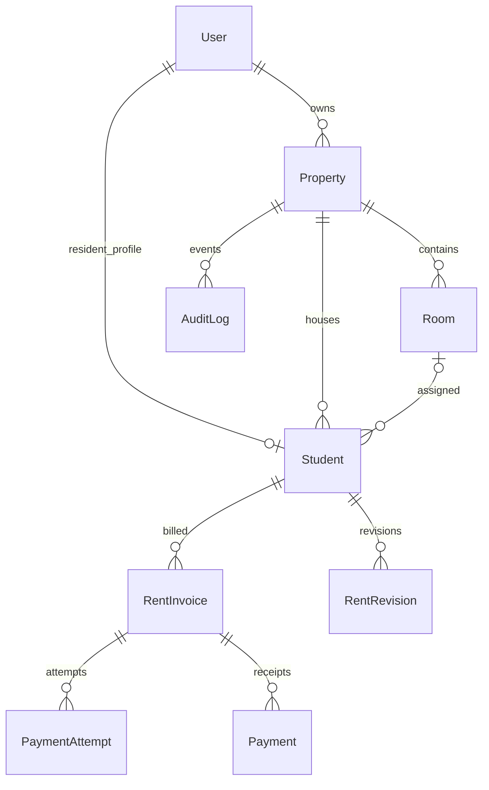

<p align="center"></p>

# PGOne

**One platform to manage PGs, hostels and co-living properties.**

PGOne is a mobile-first accommodation management application built for Indian PG owners and residents. It keeps room occupancy, resident records, invoices, rent collection and payment history in one structured workflow.

> **Product status:** Android testing build available via GitHub Actions. A public, release-signed PGOne app has **not** been shipped. Website and app are undergoing a brand migration from SafeHouse.

## Features

| Owner | Resident |
|---|---|
| Manage one or more properties, rooms, beds and occupancy | View assigned room and account |
| Add and update residents; manage rent plans and deposits | View monthly rent invoices and breakdowns |
| Review dues and collection totals | Initiate configured UPI/QR payment flows |
| Record manual payments, review payment history and receipts | Track verified payment status and download receipts |
| Send configured notices and reminders | Receive supported notices and reminders |

The app supports role-specific authentication, property context and managed session restoration. **No public resident self-signup:** an owner creates resident accounts.

## Stack

| Layer | Technology |
|---|---|
| Android | Java WebView shell, maintained HTML/CSS/JavaScript frontend |
| API | Node.js, Express, TypeScript |
| Data | PostgreSQL (Supabase managed), Prisma ORM |
| Payments | Razorpay with verified backend capture/webhook reconciliation |
| Notifications | Firebase Cloud Messaging (when configured) |
| CI | GitHub Actions for frontend tests, Android tests, screenshots and APKs |

## Repository layout

```text
mobile/frontend/src/                 Maintained mobile UI and business workflows
mobile/app/src/main/                Android native shell and vector branding
mobile/frontend/tests/              Unit/payment-state tests
mobile/frontend/e2e/                Browser journeys and screenshot tests
src/                                Backend API, authorization and payment verification
prisma/                             Schema and database migrations
.github/workflows/                  Android and backend contract CI
docs/branding/                      Canonical PGOne mark and brand notes
docs/mobile-rebuild/                Architecture, screen inventory and validation
```

## Run the backend locally

Requires Node.js, PostgreSQL credentials and properly configured environment secrets.

```bash
npm install
cp .env.example .env
npm run prisma:generate
npm run prisma:migrate:deploy
npm run dev
```

Update `.env` before running migrations. Check `http://localhost:4000/health` and `http://localhost:4000/ready`. Never commit `.env` or payment secrets.

See [API reference](API.md), [mobile integration](MOBILE_INTEGRATION.md) and [deployment checklist](DEPLOY_CHECKLIST.md) for configuration details.

## Build and test Android

```bash
cd mobile/frontend
npm ci
npm test
npm run build
npm run test:e2e
```

Browser end-to-end tests require Playwright Chromium. For Android native builds use Java 17, Gradle 8.9 and Android SDK 35, or use [GitHub Actions](.github/workflows/build-mobile-apk.yml).

After a successful workflow run, open its **PGOne-testing-APK** artifact and install the enclosed `PGOne-5.0.0-testing-<sha>.apk`. Android app label is **PGOne Testing**. The debug package ID remains `com.safehouse.pg.testing` for technical compatibility, even though the visible product brand is PGOne. Artifacts are retained for a limited period.

**Do not redistribute a debug APK as a production release.** A public production APK requires release signing, physical-device verification, actual merchant payment validation, support/privacy disclosures and a separate package migration decision.


## DBMS practical — database design and viva

PGOne uses **Supabase-hosted PostgreSQL**, accessed through the **Prisma ORM**. Its nine main relational entities are `User`, `Property`, `Room`, `Student`, `RentRevision`, `RentInvoice`, `PaymentAttempt`, `Payment` and `AuditLog`.

- **Owner → Property:** one-to-many via `Property.ownerId`.
- **Property → Rooms / Students:** one-to-many; residents have an optional room assignment.
- **Student → RentInvoice:** one-to-many; uniqueness on `(studentId, year, month)` prevents duplicate monthly invoices.
- **RentInvoice → PaymentAttempt / Payment:** a try to pay is not the same as a completed payment.
- **Primary keys:** generated string `id` values; **foreign keys:** `ownerId`, `propertyId`, `studentId`, `roomId`, `invoiceId`.
- **Indexes and unique constraints:** enable efficient property-scoped queries and protect data integrity.
- **Transactions:** Prisma `$transaction` groups related writes. Money is stored as **integer paise** to avoid floating-point errors.
- **Normalization:** entities are separated to reduce repetition; invoices deliberately snapshot billed amounts for history.

### ER relationship sketch



**Full DBMS viva preparation:** [Read the complete 30-question guide with actual schema, SQL, joins, ACID, normalization, transaction/payment workflow and live demonstration script](docs/dbms/DBMS-VIVA-GUIDE.md).

### Three quick example queries

```sql
-- Property rooms
SELECT "number", "capacity" FROM "Room" WHERE "propertyId" = :property_id;
-- Residents with assigned room
SELECT u."fullName", r."number" FROM "Student" s
JOIN "User" u ON u."id"=s."userId"
LEFT JOIN "Room" r ON r."id"=s."roomId";
-- Outstanding balance is stored in paise
SELECT "totalPaise"-"paidPaise" AS due FROM "RentInvoice" WHERE "status"='DUE';
```

## Payment integrity

The backend is intentionally unchanged by the PGOne rebrand. It still applies the audited `SAFEHOUSE_QR_SETTLEMENT_V2` settlement contract:

- Clients cannot mark invoices paid by tapping a button or returning from a UPI app.
- Captured payments are verified by server-side signatures/webhooks and processed idempotently.
- Historical invoice amounts are retained as snapshots; money is stored in integer paise.
- QR payloads are preserved and merchant settlement must be validated with actual financial-provider accounts before release.

Changing the Android brand **must never** change payment signatures, backend endpoints, callback identifiers, existing session keys or database semantics.

## Branding and migration

The customer-facing brand is **PGOne**. See [brand reference](docs/branding/README.md) for color, mark and spelling. Legacy internal paths such as `com.safehouse.pg`, `SafeHouseNative`, `safehouse-api.onrender.com` and Firebase identifiers are intentionally retained for compatibility; **they do not appear as the product name in the main user interface**. Migrating technical identifiers requires a separate tested plan and may affect upgrades or notification delivery.

## Security and current limits

No secrets belong in the APK. Production payment flow, FCM, app signing, privacy disclosures and physical Android device/OEM compatibility must be verified separately. The publicly shared repository, examples, and screenshots must not be interpreted as proof of active customers, published store availability or real financial transaction acceptance.

## License and ownership

Project ownership and reuse terms have not been publicly licensed; contact the repository owner before redistribution. Third-party dependencies and bundled fonts retain their own licenses.
