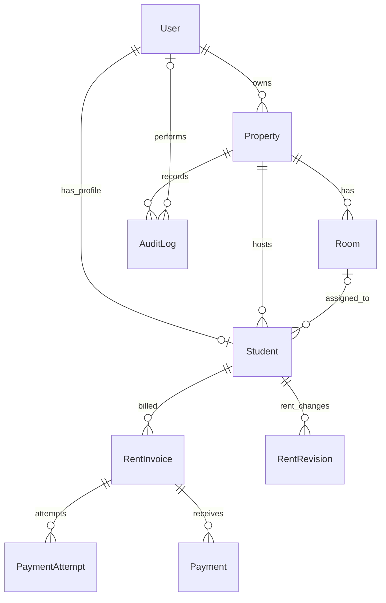

# PGOne — DBMS Project & Viva Preparation

> This guide describes the **actual PostgreSQL/Prisma schema in this repository** (not an invented college example). The Android product shown to examiners is **PGOne**; legacy technical package IDs may still contain SafeHouse for backwards compatibility.

## 1. Project introduction — 40-second viva script

“PGOne is a database-driven PG and hostel management application. We designed it to maintain owners, properties, rooms, residents, monthly rent invoices, payment attempts, successful payments, rent revisions and audit logs in a relational database. The frontend is an Android app; a Node.js/Express REST API validates business rules; Prisma maps application models to PostgreSQL hosted on Supabase. Owners manage rooms and residents; residents inspect bills and payment history. We use primary keys, foreign keys, uniqueness constraints, indexes and database transactions to keep records consistent. Payment records are only finalized after backend verification.”

**Main aim:** replace scattered spreadsheets, informal rent tracking and fragmented resident information with one consistent relational system.

## 2. System architecture and data flow

```text
PGOne Android UI (Java WebView + HTML/CSS/JS)
            |
            | authenticated HTTPS/JSON API
            v
Node.js + Express + TypeScript
  ├── input validation / owner-resident authorization
  ├── business rules (rooms, capacity, billing)
  ├── Prisma ORM
  |       |
  |       v
  |   Supabase PostgreSQL (relational records)
  |
  └── Razorpay order / QR reconciliation
               |
          signed provider webhooks
               |
        verified payment + invoice update
```

**Correct distinction:** Supabase is used here as **managed PostgreSQL hosting**; Prisma handles SQL queries/migrations. This is NOT a Firebase/NoSQL database. Firebase is used for notification-related integrations, not the main transactional database.

## 3. Actual tables/models

The canonical source is [prisma/schema.prisma](../../prisma/schema.prisma).

| Table | Primary key | Important columns | Foreign keys / purpose |
|---|---|---|---|
| `User` | `id` | `email` (unique), `passwordHash`, `fullName`, `role`, `status` | Owner/resident login identity |
| `Property` | `id` | `name`, `currency`, `timezone` | `ownerId → User.id` |
| `Room` | `id` | `number`, `capacity`, `active` | `propertyId → Property.id` |
| `Student` | `id` | `mobile`, `bedLabel`, `joiningDate`, `monthlyRentPaise`, `rentDueDay`, `status` | `propertyId → Property.id`, `userId → User.id`, optional `roomId → Room.id` |
| `RentRevision` | `id` | `amountPaise`, `effectiveYear`, `effectiveMonth`, `reason` | `propertyId → Property.id`, `studentId → Student.id` |
| `RentInvoice` | `id` | `year`, `month`, `dueDate`, rent, charges, discount, total, paid, `status` | `propertyId → Property.id`, `studentId → Student.id` |
| `PaymentAttempt` | `id` | `providerOrderId` (unique), `providerPaymentId` (unique if present), `amountPaise`, `status` | `invoiceId → RentInvoice.id`, `studentId → Student.id` |
| `Payment` | `id` | `amountPaise`, `source`, `method`, `receiptNumber` (unique), `paidAt` | `propertyId → Property.id`, `studentId → Student.id`, `invoiceId → RentInvoice.id` |
| `AuditLog` | `id` | `action`, `entityType`, `entityId`, `metadata`, `createdAt` | `propertyId → Property.id`, optional `actorUserId → User.id` |

**Important:** The table is actually named `Student` in the Prisma schema, although the app uses the more natural word **resident**. `RentRevision` captures effective-month rent changes; old invoices are not silently edited when current rent changes. `PaymentAttempt` and `Payment` are separate because starting payment ≠ receiving verified money.

### Relationships and cardinality



A property has many rooms and residents; one room can have multiple residents up to capacity. A resident has zero or one assigned room because `roomId` is nullable. A resident has invoices for multiple months. An invoice can have several payment attempts and, when relevant, multiple recorded payments. The `User`–`Student` relation is optional one-to-one because owners need not have a resident profile.

**Foreign keys:** The schema specifies cascading deletes for many property-owned child records, but `Property.ownerId` uses `Restrict` and `Student.roomId` uses `SetNull`. Explain the difference: `Cascade` deletes dependent records with a deleted parent, `Restrict` blocks parent deletion when references exist, and `SetNull` clears an optional foreign key. Financial systems should normally archive rather than casually delete transaction history.

## 4. Keys, constraints and indexes

- **Primary key (PK):** unique row identity, e.g. `Room.id`; these are Prisma `String @id @default(cuid())` identifiers.
- **Foreign key (FK):** links tables while enforcing referential integrity, e.g. `Student.roomId` references `Room.id`.
- **Unique key:** `User.email`, `Student.userId`, `Payment.receiptNumber`, `Payment.providerPaymentId`, `PaymentAttempt.providerOrderId`.
- **Composite unique constraint:** `Room(propertyId, number)` means two different properties may each contain “Room 101”, but the same property may not contain duplicate Room 101 entries. `RentInvoice(studentId, year, month)` prevents duplicate monthly invoices. `Student(propertyId, mobile)` prevents duplicate mobile numbers within the same property. `RentRevision(studentId, effectiveYear, effectiveMonth)` enforces one rent revision per student/effective month in this schema.
- **Indexes:** `Room(propertyId, active)`, `Student(propertyId, status)`, `RentInvoice(propertyId, year, month)`, `Payment(propertyId, paidAt)`, and others speed up filtered access.
- **Nullable field:** `Student.roomId` may be NULL before assignment; `Payment.method` may be unspecified in some payment records.
- **Enum:** `UserRole` contains `OWNER` and `STUDENT`; `InvoiceStatus` includes `DUE`, `PROCESSING`, `PAID`, `WAIVED`. Enums limit allowed values.

**Exam trap:** `id` is a PK, while `email` is a unique candidate key but not the declared PK. A foreign key need not be unique. A composite unique constraint is not the same as a compound primary key.

## 5. SQL examples — demonstrative, mapped to the real schema

Prisma generates SQL for PostgreSQL; these are **illustrative read queries** showing the relational operations used conceptually. Prisma usually creates quoted table/column names in this schema.

```sql
-- 1. SELECT, filtering and ordering
SELECT "number", "capacity", "active"
FROM "Room"
WHERE "propertyId" = :property_id AND "active" = TRUE
ORDER BY "number";

-- 2. INNER JOIN residents with rooms
SELECT u."fullName", s."mobile", r."number" AS room_number
FROM "Student" s
JOIN "User" u ON u."id" = s."userId"
JOIN "Room" r ON r."id" = s."roomId"
WHERE s."propertyId" = :property_id;

-- 3. LEFT JOIN includes unassigned residents
SELECT u."fullName", COALESCE(r."number", 'Unassigned') AS room
FROM "Student" s
JOIN "User" u ON u."id" = s."userId"
LEFT JOIN "Room" r ON r."id" = s."roomId"
WHERE s."propertyId" = :property_id;

-- 4. GROUP BY / aggregation for active occupancy
SELECT r."number", r."capacity", COUNT(s."id") AS assigned_residents
FROM "Room" r
LEFT JOIN "Student" s ON s."roomId" = r."id" AND s."status" = 'ACTIVE'
WHERE r."propertyId" = :property_id
GROUP BY r."id", r."number", r."capacity"
ORDER BY r."number";

-- 5. Pending amount by monthly invoice
SELECT "studentId", "year", "month", "totalPaise",
       "paidPaise", ("totalPaise" - "paidPaise") AS due_paise
FROM "RentInvoice"
WHERE "propertyId" = :property_id AND "status" IN ('DUE', 'PROCESSING');

-- 6. Total received for a property; measured in paise
SELECT COALESCE(SUM("amountPaise"), 0) AS collected_paise
FROM "Payment"
WHERE "propertyId" = :property_id;
```

**Do not run sample queries on production using a privileged SQL account.** `:property_id` is a parameter placeholder in this explanation, not a literal PostgreSQL value. The application scopes access by authenticated user and property rather than accepting arbitrary property IDs.

CRUD mapping: Create → owner adds property/room/resident; Read → dashboard and invoices; Update → edit resident, room or rent; Delete → avoid destructive deletion for historical financial data. **DML**: SELECT, INSERT, UPDATE, DELETE. **DDL**: CREATE TABLE, ALTER TABLE, DROP TABLE. **DCL**: GRANT/REVOKE. **TCL**: COMMIT/ROLLBACK/SAVEPOINT.

## 6. Normalization — what to say and what not to claim

**1NF:** a cell contains an atomic value and each row is individually identifiable. Residents and rooms are stored as separate entities rather than comma-separated lists of roommates.

**2NF:** no non-key attribute depends on only part of a candidate composite key. Many models use a single `id` as PK, so partial dependency on that single-column key is not an issue.

**3NF:** separate owner, room, resident and invoice information to reduce repeating the same property name or contact details on every record. Instead of storing resident names and room numbers on each invoice, the invoice stores `studentId` and the owner can JOIN back to user and room records.

**Deliberate snapshot/denormalization:** `RentInvoice` keeps `rentPaise`, charges and `totalPaise` even if a resident's current `monthlyRentPaise` changes. This preserves historical bill amounts and is a valid business design, not automatically a normalization defect. Some money fields such as `paidPaise` are maintained for operational performance and require consistency rules.

**Exam-safe explanation:** “Our core entity separation follows normalization principles and uses controlled historical snapshots where accounting semantics require them.” Do **not** claim a formal proof that the complete schema is BCNF or 4NF unless you can demonstrate all functional dependencies.

## 7. Transactions and ACID

Imagine recording a ₹8,500 successful payment:

1. The payment provider confirms payment; the backend verifies the provider identity and capture state.
2. The backend checks whether the unique provider payment ID is already recorded (idempotency).
3. Inside a Prisma `$transaction`, it inserts a verified `Payment` and adjusts the linked `RentInvoice`/attempt status.
4. On error, the transaction rolls back, avoiding a committed payment row with an inconsistent invoice state.

Actual implementation uses `prisma.$transaction` in [src/server.ts](../../src/server.ts). **ACID** means Atomicity (all-or-nothing), Consistency (constraints/invariants), Isolation (concurrent transactions do not corrupt one another) and Durability (committed database changes persist). PostgreSQL supplies transactional facilities; application checks additionally enforce invoice and provider-specific rules.

**Why paise?** All currency amounts are stored as integer paise to avoid binary floating-point rounding for money. ₹8,500 = `850000` paise.

**Idempotency:** repeating a signed webhook should not create a second financial payment. Unique provider IDs and transaction logic make repeated processing safe.

## 8. Important workflows explained

**Add resident:** authenticate owner → validate property ownership → check room/bed capacity and duplicate data → create login `User` and linked `Student` → record `AuditLog` → return a successful API response. The server uses transactions for related writes.

**Assign room:** pick a room under the owner’s selected property → validate capacity and resident eligibility → update the resident's `roomId` → reflect occupancy in room queries.

**Generate rent:** determine the property-local billing month, read the resident’s applicable monthly rent/revisions, generate `RentInvoice` with historic amount snapshot; `@@unique([studentId, year, month])` prevents duplicate monthly bills.

**Online payment:** create provider payment attempt → resident scans QR/opens supported UPI handler → provider-side capture is verified → record `Payment` and reconcile invoice. **Returning from UPI is not proof of payment.**

**Reports:** derive due amount, total collected, room availability and resident counts through indexed queries and joins. Never equate starting a payment attempt with money received.

## 9. 30 likely DBMS viva questions — crisp answers

1. **What is DBMS?** A system to store, retrieve, update, secure and manage data with rules.
2. **What is RDBMS?** A DBMS that models data as related tables, using keys and constraints.
3. **Why PostgreSQL?** Relational integrity, SQL, transactions, indexing and robust concurrent access.
4. **What is Supabase?** A managed service; here it hosts the PostgreSQL database.
5. **What is Prisma?** An ORM and migration tool connecting TypeScript code to PostgreSQL.
6. **Why not store data only on the phone?** Multiple owners/residents require synchronized, server-controlled data and authorization.
7. **What is a primary key?** An identifier unique to each row, e.g. `User.id`.
8. **Candidate key vs primary key?** Candidate keys can uniquely identify rows; one is selected as PK.
9. **What is a foreign key?** A column linking a related row, enforcing referential integrity.
10. **What is a composite key?** A key/uniqueness definition combining more than one attribute.
11. **Where is your composite uniqueness?** `Room(propertyId, number)` and `RentInvoice(studentId, year, month)`.
12. **What is 1:many?** One property can own many rooms.
13. **What is 1:1?** One user may have one optional `Student` profile.
14. **What is optional FK?** `Student.roomId` can be NULL before room allocation.
15. **DELETE CASCADE vs SET NULL?** Delete children vs retain child and clear its nullable reference.
16. **What is an index?** An access structure speeding lookups at additional storage/write cost.
17. **Why index propertyId?** Most queries are filtered by the active property/tenant.
18. **What is a JOIN?** Combines related tables through matching keys.
19. **INNER vs LEFT JOIN?** Inner keeps matching rows only; left retains every left-side row.
20. **What is normalization?** Organizing data to reduce unnecessary duplication and anomalies.
21. **Why historical invoice snapshots?** Later rent changes should not rewrite past billed amounts.
22. **What is ACID?** Atomicity, Consistency, Isolation, Durability.
23. **What is a transaction?** A group of operations committed or rolled back together.
24. **What is a race condition?** Concurrent operations conflict unless controlled with constraints/transactions.
25. **Why unique invoice per month?** Avoid duplicate billing for the same resident and period.
26. **What is an enum?** A type restricted to defined values, e.g. `OWNER`, `STUDENT`.
27. **What is a migration?** A version-controlled change to the database structure.
28. **Authentication vs authorization?** Authentication proves identity; authorization decides allowed actions/property scope.
29. **Why separate PaymentAttempt from Payment?** A payment attempt may fail; `Payment` records real verified transactions.
30. **What is the biggest integrity rule?** Never mark an invoice paid just because a client reports success.

## 10. Live demonstration (suggested 4–6 minutes)

1. Launch PGOne; show PGOne splash/login.
2. Owner login, show dashboard and scoped property.
3. Open rooms; explain `Property` → `Room` relationship and room capacity.
4. Open residents; explain `User` + `Student` and optional room assignment.
5. Open rent/dues; explain `RentInvoice` monthly snapshot and unique constraint.
6. Show payment-history states; explain transaction, webhook and idempotency. **Do not perform a real payment for the demonstration.**
7. Switch to schema/ER section in README and point to actual Prisma models.
8. Conclude: “The biggest DBMS advantages are consistency, reduced duplication, property-level authorization, and trustworthy payment history.”

Use a local test account and dummy data. If payment infrastructure is not available, explain a mock/demo flow without claiming real settlement.

## 11. Common traps examiners may ask

- **“Does the app use Firebase Database?”** No. PostgreSQL is the main data store; Firebase is for push notification integration.
- **“Does PostgreSQL automatically prevent overfilling rooms?”** Not by the schema's `capacity` column alone; the **backend business rule** checks occupancy. This is important!
- **“Does every student have a room?”** No, `roomId` is nullable.
- **“Why could invoice have multiple payments?”** Partial/manual amounts or multiple recorded transactions can exist; payments are distinct from attempts.
- **“What if a user pays but closes the app?”** The backend still confirms via provider verification/webhook; a phone screen is not payment evidence.
- **“Why does Java package say SafeHouse?”** Legacy internal identifier retained to protect backward compatibility during PGOne branding migration.
- **“Does this prove real payment acceptance?”** No. CI validates code and emulator flows; production provider/merchant verification is separate.
- **“What is an audit log?”** A record of sensitive actions, the actor and affected entity for accountability.
- **“Is this fully normalized?”** Entity separation is intentional, with historical snapshots. We do not claim a formal BCNF proof.
- **“What is a deadlock?”** Transactions wait cyclically on each other's locks; databases detect/resolve, and applications should keep transactions short and retry safely.

## 12. What to revise the night before viva

Be able to **draw nine entities from memory**, explain one-to-many/one-to-one relations, distinguish PK/FK/unique and JOINs, write one SELECT/JOIN/GROUP BY query, explain 1NF–3NF, ACID, transactions, indexing, authentication vs authorization, and payment idempotency. If asked a question you cannot verify from the repository, state the implemented fact rather than guessing.

**Source of truth:** [Prisma schema](../../prisma/schema.prisma), [backend payment implementation](../../src/server.ts), [README](../../README.md), [API contract](../../API.md).
